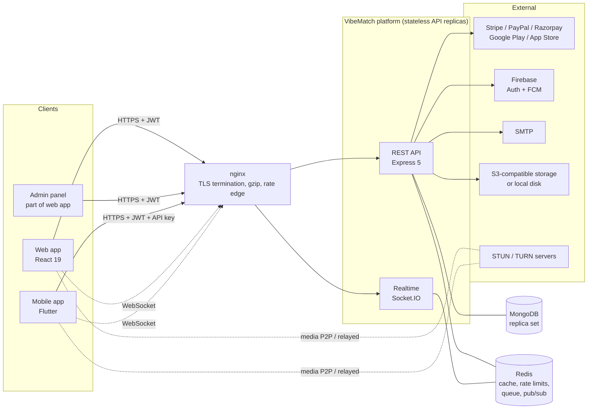
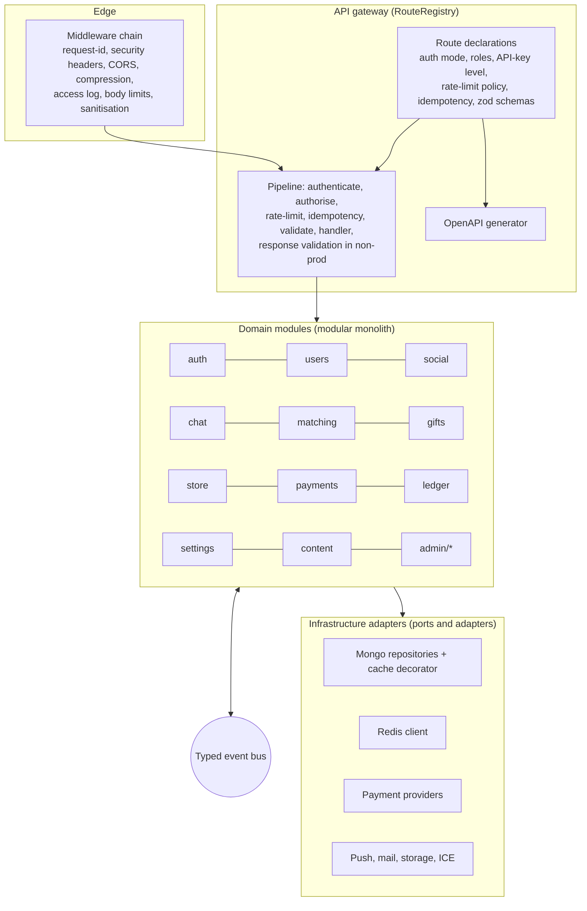
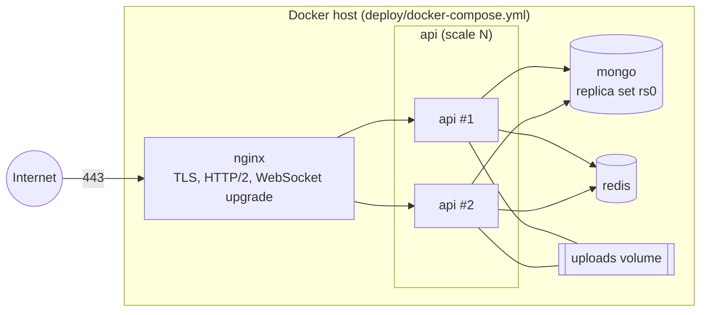
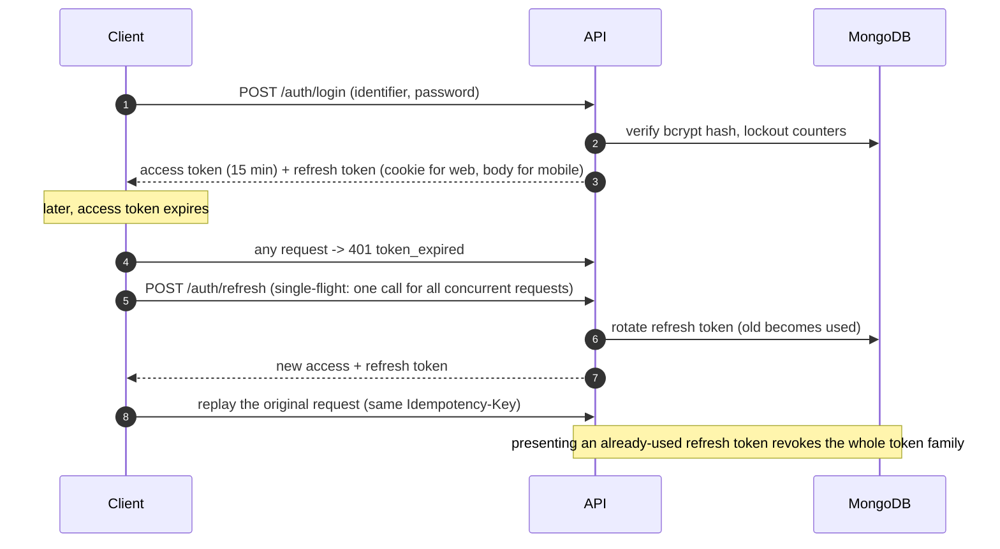
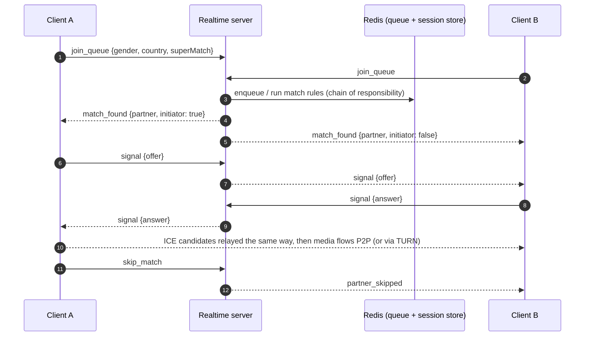
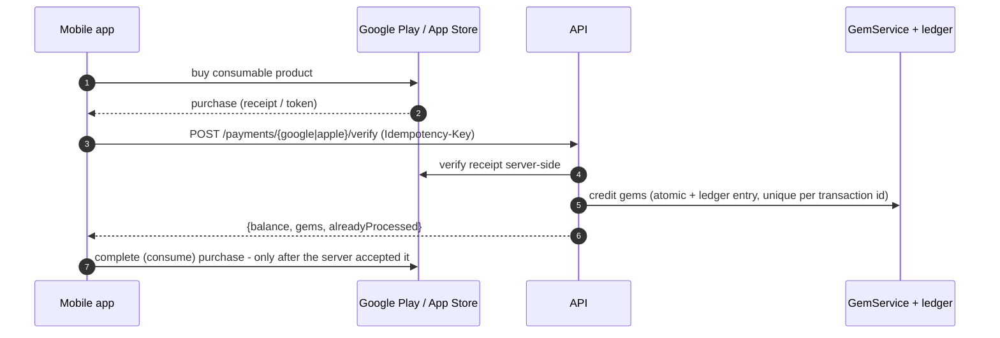
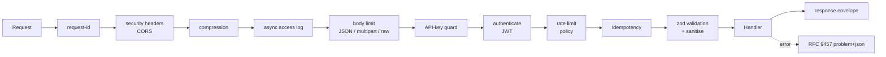
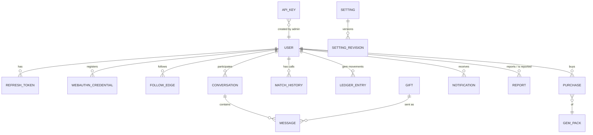
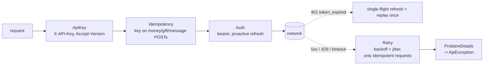

# VibeMatch v2

Random video chat and matchmaking platform: a secure, horizontally scalable API with realtime signalling, a React web
app with a full admin panel, and a Flutter mobile app.

| Component | Stack | Location | Automated tests |
|---|---|---|---|
| **Backend** | Node 22+, Express 5, TypeScript (strict), MongoDB (replica set), Redis, Socket.IO | [`backend/`](backend) | 423 (Vitest) |
| **Web + Admin** | React 19, Vite, Tailwind 4, TanStack Query, typed OpenAPI client | [`web/`](web) | 92 (Vitest, Testing Library, MSW) |
| **Mobile** | Flutter (FVM-pinned), `flutter_bloc`, go_router, dio | [`mobile/`](mobile) | 68 (`flutter_test`) |
| **Deploy** | Docker, nginx (TLS), Let's Encrypt | [`deploy/`](deploy) | `docker compose config` only |

---

## Contents

1. [Features](#1-features)
2. [High-level design (HLD)](#2-high-level-design-hld)
3. [Low-level design (LLD)](#3-low-level-design-lld)
4. [Security model](#4-security-model)
5. [Performance and scalability](#5-performance-and-scalability)
6. [API contract](#6-api-contract)
7. [Getting started](#7-getting-started)
8. [Configuration](#8-configuration)
9. [Testing and quality gates](#9-testing-and-quality-gates)
10. [Deployment](#10-deployment)
11. [Migrating from v1](#11-migrating-from-v1)
12. [Troubleshooting](#12-troubleshooting)
13. [Project status](#13-project-status)
14. [Repository layout and further reading](#14-repository-layout-and-further-reading)

---

## 1. Features

**Members**
- Random 1-to-1 video chat (WebRTC) with a matching queue, gender/country filters (VIP), "super match" (real people only), skip, in-call text chat, gifts, like and follow.
- Direct messages between mutual followers or previously matched people, with read receipts and unread counts.
- Profiles, avatar upload, notifications, call history, "who viewed me".
- Gem economy: purchase packs (Stripe, PayPal, Razorpay on web; Google Play / App Store on mobile), spend gems on gifts and VIP plans.
- Email/password, guest, and Google sign-in (Firebase ID token). Multi-language with RTL support.

**Administrators** (web `/admin`)
- Dashboard metrics, users (ban, role, gem adjustments), demo users, reports, contact mailbox, purchases (CSV export), audit log.
- Content: gifts, gem packs, VIP plans, CMS pages, languages and translations.
- Settings in groups with encrypted secrets and revision history (restore a previous version), leveled API keys, passkeys (WebAuthn), backup and restore (NDJSON).

---

## 2. High-level design (HLD)

### 2.1 System context



The API is **stateless**: sessions are JWTs plus rotating refresh tokens in MongoDB, and everything shared between replicas
(rate-limit counters, cache, matching queue, Socket.IO rooms) lives in Redis. Run `N` replicas behind nginx.
Redis is optional in development (in-memory fallbacks) and required for more than one replica.

### 2.2 Logical architecture



Key decisions (full rationale in [`docs/adr/`](docs/adr)):

| ADR | Decision |
|---|---|
| [001](docs/adr/001-modular-monolith.md) | Modular monolith with explicit module boundaries instead of microservices: one deployable, strong consistency, no network hops between modules. Modules interact through services and events only. |
| [002](docs/adr/002-events-and-cluster.md) | A typed in-process event bus; cross-replica fan-out for realtime goes through the Socket.IO Redis adapter. |
| [003](docs/adr/003-gem-ledger.md) | Gems only move through `GemService`: an atomic, guarded `$inc` plus an immutable ledger entry in the same transaction. Balances can be audited and rebuilt from the ledger. |

### 2.3 Deployment view



### 2.4 Key runtime flows

**Authentication and token refresh** (refresh-token rotation with reuse detection)



**Matching and WebRTC signalling** (the server only relays opaque signals between two matched peers)



**Store purchase (mobile)** - the device reports, the server decides



---

## 3. Low-level design (LLD)

### 3.1 Backend

```
backend/src
├── server.ts            process entry: env, graceful shutdown (HTTP, sockets, DB, Redis)
├── compose.ts           composition root: builds services, returns {app, services, realtime}
├── app.ts               createApp(): middleware chain + module registration
├── container.ts         lightweight dependency container
├── config/env.ts        every environment variable validated by zod at boot (fails fast)
├── gateway/route-registry.ts   declarative routes -> pipeline + OpenAPI + authorisation matrix
├── core/                errors (RFC 9457), logger (async pino), pagination (cursor/offset),
│                        cache, events (typed bus), security (JWT, crypto, hashing), http helpers
├── middleware/          request-id, security, rate-limit (memory / Redis Lua), authenticate,
│                        idempotency, sanitize, upload (magic-byte sniffing), ip-allowlist, error-handler
├── infra/               db (mongoose models + connection), redis, mail, push, storage
├── modules/<name>/      routes + service (+ repository, providers) per bounded context
├── realtime/            Socket.IO server, per-socket rate limiter
├── docs/                OpenAPI generation from the registry
└── migration/legacy.ts  v1 -> v2 data migration
```

**Route declaration.** A route is declared once; omitting `auth` throws at boot (deny by default).

```ts
v1.add({
  method: 'post', path: '/vip-plans/:planId/subscribe',
  auth: 'user',                // public | user | admin
  apiKey: 'mobile',            // optional minimum API-key level
  rateLimit: 'sensitive',      // named policy
  idempotent: 'required',      // Idempotency-Key header
  schema: { params, body, response },   // zod; unknown keys rejected
  handler: async ({ auth, params }) => ({ data: await vip.subscribe(auth.userId, params.planId) }),
});
```

That one declaration produces the middleware order, input validation, `docs/openapi.json` (a test fails if it is stale),
and a role x route authorisation test matrix.

**Request pipeline**



**Data model (MongoDB, abridged)**



Models are grouped in `infra/db/models/{user,auth,social,commerce,content}.ts`. Indexes are explicit; production runs
with `MONGO_AUTO_INDEX=false` and `npm run db:indexes` during deploys. Retention uses TTL indexes (history, audit log).

**Gem ledger (money integrity).** Every balance change goes through `GemService` via a command (`DebitGemsCommand`,
credit, adjust): a single transaction does a guarded `findOneAndUpdate` (`gems >= amount` so a balance can never go
negative, even under concurrency) and inserts an immutable ledger row. Purchases are unique on provider transaction id,
so a replayed webhook or receipt cannot credit twice.

**Matching.** Waiting users sit in a queue (Redis when configured). When a user joins, candidate pairs are checked by a
chain of rules (not self, not blocked/recently matched, gender/country filters for VIPs, super-match excludes demo
profiles) and the first valid pair is atomically removed from the queue and registered in the session store. If no real
partner is available and the user allows it, a demo profile is served (video file, no peer connection).

**Realtime security.** The socket handshake requires a valid access token. Signalling is only relayed between the two
users in an active session; every event has a per-socket rate limit and an ack with `{ok, error?}`.

**Design patterns in use**

| Pattern | Where |
|---|---|
| Strategy | payment providers, ICE server selection, captcha verifier, rate-limit store (memory / Redis) |
| Factory / Abstract factory | provider factories chosen from admin settings |
| Adapter (ports and adapters) | mail, push, storage, Firebase verifier, store billing |
| Decorator | `cachedRepository` wraps repositories with caching |
| Observer | typed event bus; Socket.IO events |
| Command | `DebitGemsCommand` and other ledger commands |
| Mediator | `MatchingService` coordinates queue, rules, sessions |
| Chain of responsibility | middleware pipeline, match rules |
| Facade | `PaymentService` hides providers, ledger and purchases behind checkout / verify / webhook |
| Builder | `ResponseBuilder` (envelope, pagination meta) |
| Proxy | cache and idempotency wrappers |

### 3.2 Web app (`web/`)

```
web/src
├── app/          providers, router (lazy routes), layout, header, overlays
├── shared/
│   ├── api/      openapi-fetch client + generated types (schema.d.ts), errors (problem+json),
│   │             in-memory session store, single-flight token refresh, idempotency keys
│   ├── socket/   Socket.IO provider (token via auth callback, refresh on token_expired)
│   ├── i18n/     translations (English text is the key), RTL
│   └── ui/       accessible primitives (Modal, Button, FormField, Avatar ...)
└── features/     auth, session, matching, messages, history, notifications, profile, shop,
                  content (CMS, contact, 404), install wizard, admin/*
```

- **Types come from the API contract:** `npm run api:types` regenerates `shared/api/schema.d.ts` from `docs/openapi.json`.
- **Tokens:** the access token lives in memory only; the refresh token is an `httpOnly` cookie (`X-Client-Type: web`). A request that fails with an expired token is refreshed once (single-flight) and replayed byte-for-byte with the same `Idempotency-Key`.
- **State:** server state in TanStack Query; UI state (open dialogs, auth reason) in `UiProvider`; session in `SessionProvider`.
- **Admin:** lazy-loaded routes behind a role guard (the API enforces the role on every call; the guard only hides UI). Tables are server-paged and filtered.

### 3.3 Mobile app (`mobile/`)

Feature-first, `flutter_bloc` (Cubits), repositories injected with `RepositoryProvider`.

```
mobile/lib
├── main.dart, bootstrap.dart, app.dart     startup, providers, MaterialApp.router
├── core/
│   ├── di/dependencies.dart    AppDependencies: config, repositories, platform ports (built once)
│   ├── network/                dio client + interceptors (below)
│   ├── storage/token_store.dart  secure storage (Keychain / Keystore) with in-memory fallback
│   ├── router/app_router.dart  go_router + pure `redirectFor` guard
│   ├── l10n/, theme/, utils/paged.dart (PagedCubit)
│   └── config/app_config.dart  compile-time config (--dart-define)
├── services/                   ports + implementations: socket, webrtc, iap, social sign-in, push
└── features/<name>/{data,domain,presentation}   auth, matching, messages, profile,
                                                  notifications, store, settings, home
```

**dio interceptor chain** (order matters)



Platform plugins (Socket.IO, WebRTC, in-app purchase, Google sign-in, push) sit behind interfaces in `lib/services`, so
cubits are tested with fakes and the UI never touches a plugin directly.

---

## 4. Security model

How the "12 API security tips" are applied:

| Tip | Implementation |
|---|---|
| HTTPS | TLS terminated at nginx; HSTS, secure cookies and a hard `https` check on `PUBLIC_URL` in production |
| OAuth 2.0 | Short-lived access tokens, rotating refresh tokens with reuse detection (token-family revocation); RFC 6749 `/auth/token`, RFC 7009 `/auth/revoke` |
| WebAuthn | Passkeys for administrators (`@simplewebauthn/server`); optional "require passkey" |
| Leveled API keys | `public < mobile < partner < admin`; keys are hashed at rest, shown once, rotatable and revocable; a key caps what a token can do |
| Authorization | Deny by default (routes without an auth declaration fail at boot); role checks; object-level checks (no user-supplied ids trusted); generated role x route test matrix |
| Rate limiting | Named policies (global, user, auth, sensitive, upload); Redis Lua counters; `RateLimit-*` and `Retry-After` headers; per-socket limits |
| API versioning | `/api/v1` plus `Accept-Version`; unsupported version returns 406 |
| Whitelisting | CORS origin allow-list, optional admin IP/CIDR allow-list, strict zod schemas that reject unknown fields, file-type allow-lists with magic-byte sniffing |
| OWASP API Top 10 | Mapped control by control in [`docs/security/owasp-api-top10.md`](docs/security/owasp-api-top10.md), including a table of v1 vulnerabilities and their fixes |
| API gateway | `RouteRegistry` is the single choke point: auth, quotas, validation, idempotency, logging, OpenAPI |
| Error handling | RFC 9457 `application/problem+json` with stable `code`; no stack traces or internals in responses; request ids for support |
| Input validation | zod on params, query, body and (outside production) responses; HTML sanitisation for CMS content |

Additional controls: bcrypt password hashing with login lockout, AES-256-GCM encryption of secrets stored in settings,
HMAC-signed pagination cursors, atomic gem ledger, idempotency keys on every money-moving call, audit log of admin
actions, uploads re-validated by content (not extension), `npm audit --omit=dev` clean at time of writing.

---

## 5. Performance and scalability

| Concern | Technique |
|---|---|
| Large lists | Cursor (keyset) pagination for feeds and messages; offset pagination only for admin tables |
| Logging | Asynchronous, buffered pino logger (`LOG_FLUSH_MS`) so request threads never block on I/O |
| Caching | `cachedRepository` decorator with TTL (`CACHE_TTL_SECONDS`); settings and catalogues cached; `Cache-Control` on public bundles |
| Payload size | gzip compression, lean DTOs, streamed NDJSON for exports and backups |
| Database connections | Tuned Mongo pool (`MONGO_MAX_POOL_SIZE`, `MIN`, idle time); explicit indexes; TTL indexes for retention |
| Horizontal scale | Stateless API; Redis for shared state; Socket.IO Redis adapter; `docker compose up -d --scale api=N` |
| Resilience | Idempotent writes, bounded retries with backoff on clients, graceful shutdown, `/health/live` and `/health/ready` |
| Observability | Prometheus metrics, request ids, structured JSON logs |

---

## 6. API contract

- **Base path:** `/api/v1`. Interactive spec: `GET /openapi.json` (when `EXPOSE_OPENAPI=true`) or [`docs/openapi.json`](docs/openapi.json) (109 paths, generated from the route registry).
- **Success:** `{ "data": ..., "page"?: ..., "meta": { "requestId": "..." } }`.
- **Errors:** RFC 9457 `application/problem+json`, e.g.

  ```json
  { "type": "about:blank", "title": "Validation failed", "status": 422, "code": "validation_failed",
    "detail": "...", "errors": [{ "path": "email", "message": "Invalid email" }], "requestId": "..." }
  ```
  Clients switch on `code`, never on message text.
- **Authentication:** `Authorization: Bearer <access token>`; web sends `X-Client-Type: web` and receives the refresh token as an `httpOnly` cookie.
- **API keys:** `X-API-Key`. `GET /init` (mobile bootstrap) requires a `mobile`-level key.
- **Pagination:** `?limit=&cursor=` returns `page: { limit, hasMore, nextCursor }`. Admin tables use `?page=&pageSize=` and return `{ page, pageSize, total, totalPages }`.
- **Idempotency:** `Idempotency-Key` is required for gift sends and VIP purchases, optional for messages and payment verification. Same key and body replays the stored response (`Idempotent-Replayed: true`); same key with a different body returns 422; a request still in flight returns 409.
- **Rate limits:** `RateLimit-Limit`, `RateLimit-Remaining`, `RateLimit-Reset`; 429 with `Retry-After`.
- **Realtime (Socket.IO, `auth: { token }`):**
  - client to server (all acknowledged): `join_queue`, `leave_queue`, `skip_match`, `signal`, `send_message`, `send_gift`
  - server to client: `match_found`, `signal`, `partner_skipped`, `receive_message`, `new_message_notification`, `partner_liked`, `online_users_count`, `match_error`

---

## 7. Getting started

### 7.1 Prerequisites

| Tool | Version | Notes |
|---|---|---|
| Node.js | 22 or newer | backend and web |
| MongoDB | 6+ **as a replica set** | transactions require it; see the no-Docker option below |
| Redis | 7+ | optional for a single dev instance |
| Docker | recent | optional (compose files for Mongo/Redis and for production) |
| [FVM](https://fvm.app) | latest | mobile only; the Flutter version is pinned in `mobile/.fvmrc` |
| Xcode / Android Studio | current | mobile builds |

### 7.2 Backend

```bash
cd backend
cp .env.example .env                 # set MONGODB_URI, JWT_SECRET (openssl rand -base64 48),
                                     # SETTINGS_ENCRYPTION_KEY (openssl rand -base64 32)
npm install

# MongoDB replica set - pick one:
docker compose -f ../deploy/docker-compose.dev.yml up -d      # Mongo + Redis
#   or, without Docker (in-memory-server binary, data persisted in .dev-data/):
npm run dev:db                       # leave running; URI: mongodb://127.0.0.1:27017/vibematch?replicaSet=testset

npm run dev                          # http://localhost:3000   (loads .env)
npm run seed                         # optional: 4 packs, 2 VIP plans, 30 gifts, 6 demo profiles
ADMIN_PASSWORD='Choose-A-Strong-One' npm run admin:create -- --username boss --email you@example.com
```

`admin` is a reserved username. Alternatively use the one-time installer (`/install` in the web app,
`POST /api/v1/install/complete`).

### 7.3 Web and admin panel

```bash
cd web
npm install
npm run dev                          # http://localhost:5173 (proxies /api, /socket.io, /images to :3000)
```

Sign in with the administrator account, then open `/admin` (or *Admin* in the profile menu).

### 7.4 Mobile

```bash
cd mobile
fvm install                          # installs the pinned Flutter SDK
fvm flutter pub get
# Create a mobile-level API key in Admin -> API keys, then:
fvm flutter run -d <device-id> \
  --dart-define=API_BASE_URL=http://localhost:3000 \
  --dart-define=API_KEY=<mobile key>
```

Android emulators reach the host at `http://10.0.2.2:3000`. See [`mobile/README.md`](mobile/README.md) for Firebase setup
and platform notes.

---

## 8. Configuration

All backend settings are environment variables validated at boot (a bad value prevents startup with a clear message).
The full annotated list is in [`backend/.env.example`](backend/.env.example). The essentials:

| Variable | Purpose |
|---|---|
| `NODE_ENV`, `PORT`, `PUBLIC_URL` | runtime mode, listen port, public base URL (https in production) |
| `CORS_ORIGINS` | comma-separated browser origins (no wildcard) |
| `MONGODB_URI`, `MONGO_*_POOL_SIZE` | database and pool sizing |
| `REDIS_URL` | enables shared rate limits, cache, queue, socket adapter |
| `JWT_SECRET`, `ACCESS_TOKEN_TTL_SECONDS`, `REFRESH_TOKEN_TTL_DAYS` | token signing and lifetimes |
| `SETTINGS_ENCRYPTION_KEY` | 32-byte base64 key encrypting stored secrets (**back it up**) |
| `ADMIN_IP_ALLOWLIST`, `REQUIRE_ADMIN_PASSKEY`, `WEBAUTHN_*` | admin hardening |
| `RATE_LIMIT_*` | per-window limits per policy |
| `FIREBASE_SERVICE_ACCOUNT_JSON` | verifies social sign-in tokens and sends push |
| `DEMO_MODE` | serve demo profiles when no real partner is available |

Payment gateways, SMTP, storage, reCAPTCHA, branding and feature flags are managed at runtime in **Admin -> Settings**
(secrets are encrypted at rest and masked in the UI).

Mobile uses compile-time `--dart-define` values: `API_BASE_URL`, `API_KEY`, optional `PINNED_SHA256`.

---

## 9. Testing and quality gates

| Layer | Tooling | What is covered |
|---|---|---|
| Backend unit and integration | Vitest, supertest, in-memory MongoDB replica set, real Redis | every module's routes, authorisation matrix (role x route), BOLA cases, idempotent replay, pagination, rate limiting, problem+json shapes, ledger concurrency, payment strategies, socket flows, a two-instance cluster test |
| Contract | OpenAPI snapshot test | `docs/openapi.json` must match the route registry |
| Web | Vitest, Testing Library, MSW | API client (refresh, replay), auth, messaging, shop, profile, admin tables and forms, router shell |
| Mobile | `flutter_test`, bloc/cubit tests with fakes | interceptors (single-flight refresh, retry, idempotency), paging, localisation cache, session, matching state machine, messages, purchases, router guard, auth screen |

```bash
cd backend && npm run verify          # lint + typecheck + tests with coverage gates
cd web     && npm run verify          # lint + typecheck + tests with coverage gates
cd mobile  && fvm flutter analyze && fvm flutter test
```

Coverage gates: backend >= 80 % lines/functions/statements and >= 70 % branches (currently ~96 % lines);
web >= 70 % lines, 65 % functions, 60 % branches (currently ~81 % lines).

---

## 10. Deployment

`deploy/install.sh <domain> <email>` on a fresh Ubuntu 22.04/24.04 host installs Docker, generates secrets, obtains a
Let's Encrypt certificate and starts nginx, the API, MongoDB (replica set) and Redis.

```bash
cd deploy
cp .env.example .env                 # fill in secrets
docker compose up -d
docker compose up -d --scale api=3   # scale the stateless API
```

- **Back up `deploy/.env`.** `SETTINGS_ENCRYPTION_KEY` is required to read stored gateway secrets.
- Run `npm run db:indexes` during deploys (production runs with `MONGO_AUTO_INDEX=false`).
- Health checks: `GET /health/live` and `GET /health/ready`.
- Build the web app with `npm run build` in `web/` and serve `dist/` from nginx (`/usr/share/nginx/html` in the provided template, which also proxies `/api`, `/socket.io`, `/images` and `/videos`).
- The Docker, nginx and `install.sh` assets have **not** been exercised end-to-end in this repository's CI; verify them on a staging host first.

---

## 11. Migrating from v1

```bash
cd backend
npm run migrate:legacy -- --source mongodb://.../vibematch --target mongodb://.../vibematch_v2          # dry run
SETTINGS_ENCRYPTION_KEY=... npm run migrate:legacy -- --source ... --target ... --apply                  # write
```

Passwords keep working (bcrypt hashes are carried over), ids are preserved, follower arrays become edges, gem balances
receive opening ledger entries, and settings are split into encrypted groups. The v1 mobile API key is replaced by a
leveled key (create one in Admin -> API keys).

---

## 12. Troubleshooting

| Symptom | Cause and fix |
|---|---|
| `Invalid environment configuration: MONGODB_URI / JWT_SECRET` | Variables not loaded. Use `npm run dev` (loads `.env`) or export them; scripts run with `tsx --env-file=.env`. |
| Transactions or `Transaction numbers are only allowed on a replica set` | MongoDB is not a replica set. Use the dev compose file or `npm run dev:db`. |
| `create-admin` fails validation | `admin` and similar names are reserved; pick another username. |
| Admin pages show "Administrators only" | Signed in with a non-admin account. Create one with `npm run admin:create`. |
| Mobile app crashes immediately on iOS 27 | The app must use the UIScene lifecycle (done in this repo: `AppDelegate` + `Info.plist` scene manifest). |
| Mobile app aborts at launch with `FIRApp ... NSException` | `ios/Runner/GoogleService-Info.plist` contains placeholder values. Add your own Firebase files (see `mobile/README.md`); the placeholder is intentionally not bundled. |
| Mobile app stuck on the splash screen in the simulator | Keychain error `-34018` on unsigned simulator builds. The token store falls back to memory (tokens are not persisted across restarts in that case). |
| `Connecting to the VM Service is taking longer than expected` | The app died on start; read the iOS crash report in `~/Library/Logs/DiagnosticReports` or run `fvm flutter run -v`. |
| iOS build: "deployment target is too low" | All pods must target iOS 15 or newer (set in `ios/Podfile`). |

---

## 13. Project status

| Area | State |
|---|---|
| Backend | Complete; 423 tests; `npm run verify` green; compiled build passes the boot smoke test |
| Web and admin | Complete for the scoped features; 92 tests; `npm run verify` green |
| Mobile | Runs on the iOS simulator; analyze clean; 68 tests; integration test not yet run; real WebRTC / IAP / FCM not yet exercised on devices |

Known gaps (tracked in [`../.claude/specs/vibematch-v2/tasks.md`](../.claude/specs/vibematch-v2/tasks.md)):
- Admin response schemas are not yet declared in OpenAPI, so the admin UI uses hand-written row types (task W2.5).
- Playwright end-to-end smoke test and Docker/nginx/`install.sh` verification need a running Docker daemon (W2.6, B10.4).
- Mobile: AdMob, FCM token registration, Stripe WebView checkout, phone/Apple sign-in and the in-call report dialog are not implemented.
- Web: no service worker (PWA manifest only).
- Phase X (cross-system end-to-end run, documentation refresh in `Documontation/`, k6 load test) not started.

---

## 14. Repository layout and further reading

```
vibematch-v2/
├── backend/    API + realtime server (src/, scripts/, tests/)
├── web/        React app: public site + /admin
├── mobile/     Flutter app (android/, ios/, lib/, test/, integration_test/)
├── deploy/     Dockerfile, docker-compose (prod + dev), nginx template, install.sh
└── docs/       openapi.json (generated), adr/, security/owasp-api-top10.md
```

| Document | Contents |
|---|---|
| [`../.claude/specs/vibematch-v2/requirements.md`](../.claude/specs/vibematch-v2/requirements.md) | Requirements with ids referenced by tasks and tests |
| [`../.claude/specs/vibematch-v2/design.md`](../.claude/specs/vibematch-v2/design.md) | Detailed design and recorded deviations |
| [`../.claude/specs/vibematch-v2/tasks.md`](../.claude/specs/vibematch-v2/tasks.md) | Task checklist and status |
| [`docs/adr/`](docs/adr) | Architecture decision records |
| [`docs/security/owasp-api-top10.md`](docs/security/owasp-api-top10.md) | OWASP API Top 10 mapping and the v1 vulnerability fix table |
| [`mobile/README.md`](mobile/README.md) | Mobile toolchain (FVM), Bloc structure, Firebase setup, known gaps |

**Contributing.** Work one task at a time and keep it green: `npm run verify` (backend/web) and
`fvm flutter analyze && fvm flutter test` (mobile) must pass before a change is considered done. After changing routes,
run `npm run openapi` in `backend/` and `npm run api:types` in `web/`.
